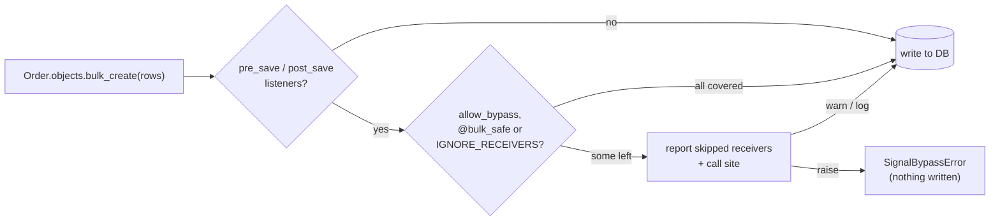

<div align="center">

# 🛡️ django-signal-guard

**Make Django signal failures loud.**

Catch the bulk writes that silently skip your `pre_save` / `post_save` receivers,<br>
the receivers that never get connected, and the ones that run twice.

[](https://github.com/panosangelopoulos/django-signal-guard/actions/workflows/ci.yml)
[](#-install)
[](#-install)
[](#%EF%B8%8F-roadmap)
[](https://peps.python.org/pep-0561/)
[](https://github.com/astral-sh/ruff)
[](LICENSE)

[Quick start](#-quick-start) •
[Bypass guard](#-the-bypass-guard) •
[System checks](#-system-checks) •
[signals.lock](#-the-signal-map-and-signalslock) •
[Configuration](#%EF%B8%8F-configuration) •
[How it works](#-how-it-works)

</div>

---

## 💥 The problem

```python
Order.objects.bulk_create(rows)          # post_save never fires
Order.objects.filter(...).update(...)    # neither does pre_save
```

`bulk_create()`, `bulk_update()` and `update()` write rows **without calling
`Model.save()`**, so your `pre_save` and `post_save` receivers never run.

Nothing errors. The search index goes stale, the audit log has gaps, a cache is
never invalidated. You usually find out days later, in production.

## ✅ The fix

`django-signal-guard` catches those writes in development, tests and CI, and
tells you exactly which receivers were skipped and where the call came from:

```text
SignalBypassError: QuerySet.bulk_create() on shop.Order skips 2 receivers:
  pre_save   shop.signals.normalize_status  (shop/signals.py:5)
  post_save  shop.signals.reindex_order  (shop/signals.py:9)
Called from shop/imports.py:42.
Run the receivers' work yourself, or wrap the call in signal_guard.allow_bypass(Order, reason="...").
```

It doesn't add new signals or replace them with hooks. Your signals stay
exactly as they are. It just **reports misuse**, the way
[`nplusone`](https://github.com/jmcarp/nplusone) and
[`django-seal`](https://github.com/charettes/django-seal) report lazy queries.

## ✨ What's inside

| | Feature | What it catches |
| :---: | --- | --- |
| 🚧 | **[Bypass guard](#-the-bypass-guard)** | Bulk writes that skip receivers: raise, warn or log. |
| 🩺 | **[System checks](#-system-checks)** | Receivers that never run, only run in some processes, die silently, or run twice. |
| 🔒 | **[`signals.lock`](#-the-signal-map-and-signalslock)** | A committed inventory of every receiver, checked in CI, so new receivers show up in code review. |

---

## 📦 Install

```bash
pip install django-signal-guard
```

> [!NOTE]
> The package isn't on PyPI yet. Until the first release, install from GitHub:
> `pip install git+https://github.com/panosangelopoulos/django-signal-guard`

Requires **Python 3.10+** and **Django 5.2+**.

## 🚀 Quick start

**1. Add it to `INSTALLED_APPS`, first in the list:**

```python
# settings.py
INSTALLED_APPS = [
    "signal_guard",  # first, so it sees every receiver being connected
    # ...
]
```

**2. Make bypasses fail your tests:**

```python
# settings/test.py
SIGNAL_GUARD = {"BYPASS": "raise"}
```

**3. Add two lines to CI:**

```bash
python manage.py check --tag signals --fail-level WARNING
python manage.py signal_map --check
```

That's it. Everywhere else, the default is `"warn"`.

---

## 🚧 The bypass guard

Every `bulk_create()`, `bulk_update()` and `update()` (plus `abulk_create()`,
`abulk_update()`, `aupdate()`) is checked against the live `pre_save` and
`post_save` receivers for that model. A model with no receivers costs a single
`has_listeners()` call.

### When skipping is intended

Wrap the call in `allow_bypass` and say why. The `reason` is **required**, so
the decision is written down next to the code:

```python
from signal_guard import allow_bypass

with allow_bypass(Order, reason="import reindexes in one batch"):
    Order.objects.bulk_create(rows)
reindex_orders(rows)
```

- `allow_bypass()` with no models allows every model.
- It also works as a **decorator** and with **`async with`**.

### Receivers that never matter for bulk writes

Mark them once with `@bulk_safe`:

```python
from django.db.models.signals import post_save
from django.dispatch import receiver
from signal_guard import bulk_safe


@receiver(post_save, sender=Order)
@bulk_safe
def warm_cache(sender, instance, **kwargs): ...
```

<details>
<summary><b>What the guard covers, and what it doesn't</b></summary>

<br>

**Covered**

- `bulk_create()`, `bulk_update()` and `update()`, called on a manager, a
  queryset, or your own `QuerySet` subclass methods.
- The async variants `abulk_create()`, `abulk_update()` and `aupdate()`.
- Receivers connected to the model, and receivers connected to every sender.
- `bulk_update()` is reported once, even though Django runs `update()` inside it.

**Not covered**

- Raw SQL, `cursor.execute()`, database triggers and other writes that never
  go through a `QuerySet`.
- `QuerySet.delete()`. It *does* send `pre_delete` and `post_delete`; it only
  skips your model's own `delete()` method.
- Logic in an overridden `Model.save()` with no signal receiver. The guard only
  knows about receivers.
- A `QuerySet` subclass that overrides one of the three methods and never calls
  `super()`.

</details>

---

## 🩺 System checks

```bash
python manage.py check --tag signals
```

| ID | Finds | Why it matters |
| --- | --- | --- |
| **`W001`** | A module in one of your apps defines `@receiver` functions, but nothing imports it. | The decorator never runs, so the receiver never runs. The classic *"my signal doesn't fire"*. |
| **`W002`** | A receiver is connected only after startup, by a lazy import such as `views.py` importing your signals module. | Web requests run it, but **Celery workers**, management commands and some tests never do. |
| **`W003`** | A weakly connected function or lambda was garbage-collected. | Django holds receivers by weak reference, so a nested function or lambda silently stops running. |
| **`W004`** | The same receiver is connected more than once to one signal and sender. | Every copy runs, so **emails go out twice**. |

<details>
<summary><b>Example output</b></summary>

```text
shop.webhooks: (signal_guard.W002) shop.webhooks.send_webhook is connected only after startup, when shop/views.py:2 imports it.
	HINT: Processes that never run that import, such as Celery workers, management commands and some tests, never run this receiver. Import shop.webhooks in shop.apps.ShopConfig.ready().
```

</details>

All four are warnings, so they never stop `runserver`. Silence one with
`SILENCED_SYSTEM_CHECKS = ["signal_guard.W004"]`.

---

## 🔒 The signal map and `signals.lock`

See which receivers run for which signal and sender: yours, plus third-party
receivers that run on your models (add `--all` for Django's internals).

```console
$ python manage.py signal_map
First-party receivers (3)
  django.db.models.signals.post_save
    shop.Order
      shop.signals.reindex_order  (shop/signals.py:9)
      shop.webhooks.send_webhook  (shop/webhooks.py:6)
  django.db.models.signals.pre_save
    shop.Order
      shop.signals.normalize_status  (shop/signals.py:5)
```

Commit the same list as a lock file:

```bash
python manage.py signal_map --write   # writes signals.lock
python manage.py signal_map --check   # fails with a diff when it's out of date
```

```text
[first-party]
django.db.models.signals.post_save | shop.Order | shop.signals.reindex_order
django.db.models.signals.post_save | shop.Order | shop.webhooks.send_webhook
django.db.models.signals.pre_save | shop.Order | shop.signals.normalize_status
```

One line per receiver, no line numbers, so the file only changes when a
receiver is added, removed or moved. That includes receivers a **dependency
upgrade** quietly adds to your models.

---

## ⚙️ Configuration

Every key is optional:

```python
SIGNAL_GUARD = {
    "BYPASS": "warn",              # raise | warn | log | off
    "IGNORE_RECEIVERS": [],        # fnmatch patterns, e.g. ["simple_history.*"]
    "CHECK_LIBRARY_CALLS": False,
    "FIRST_PARTY": None,           # e.g. ["shop", "billing"]
    "LOCK_FILE": "signals.lock",
    "ENABLED": True,
}
```

| Key | Default | Description |
| --- | --- | --- |
| `BYPASS` | `"warn"` | `raise` stops the write with `SignalBypassError` **before anything reaches the database**. `warn` emits a `SignalBypassWarning`. `log` writes to the `signal_guard` logger. `off` does nothing. |
| `IGNORE_RECEIVERS` | `[]` | Receivers whose dotted path matches one of these patterns are never reported. Handy for third-party receivers you can't change. |
| `CHECK_LIBRARY_CALLS` | `False` | Also report bulk writes made inside Django or installed packages, such as the `UPDATE` behind `on_delete=SET_NULL`. |
| `FIRST_PARTY` | `None` | Module prefixes of your own code. By default, anything not Django and not in site-packages counts as yours. |
| `LOCK_FILE` | `"signals.lock"` | Where `signal_map --write` / `--check` keep the lock file. Relative paths resolve against `settings.BASE_DIR` when it exists. |
| `ENABLED` | `True` | When `False` at startup, nothing is wrapped and the checks do nothing. |

> [!TIP]
> Settings are read on every call, so `override_settings` just works in tests.

---

## 🔍 How it works



- **Bypass guard.** On app load it wraps `QuerySet.bulk_create`, `bulk_update`
  and `update`. Before each write it asks Django's dispatcher which `pre_save`
  and `post_save` receivers are live for the model, drops those marked
  `@bulk_safe` or matching `IGNORE_RECEIVERS`, and reports the rest.
- **Registry.** It wraps `Signal.connect()` and `disconnect()` to record where
  and when each receiver was connected. It holds only weak references, so it
  never keeps a receiver alive. That's why `signal_guard` should come **first**
  in `INSTALLED_APPS`: a receiver connected before it loads has no record, so
  W003 can't see it die.
- **Checks and map.** They import your URLconf first, as a running server
  would, then read Django's live receivers. W001 also parses your apps' modules
  (skipping tests and migrations) to find `@receiver` functions.

---

## 🗺️ Roadmap

| Version | Adds | |
| --- | --- | :---: |
| 0.1 | Bypass guard | ✅ |
| 0.2 | System checks W001–W004, `manage.py signal_map`, `signals.lock` | ✅ |
| 0.3 | Recursion tracing, `@receiver_on_commit`, a check for side effects before commit | 🔜 |
| 1.0 | pytest plugin and test assertions, full documentation | 🔜 |

See the [changelog](CHANGELOG.md) for details.

## 📚 Prior art

- **Johnny Metz's post** on blocking bulk operations that skip signals, which
  shows the same idea as a custom `QuerySet`.
- **`django-bulk-signals`, `django-bulk-tracker`** and similar packages add
  *new* bulk signals. Use them if you want receivers that do run on bulk writes;
  `django-signal-guard` tells you when your *existing* receivers don't.
- **`django-lifecycle`** replaces signals with model hooks.

## 🧑‍💻 Development

```bash
uv sync --group dev
uv run pytest
uv run ruff check . && uv run ruff format --check .
```

Issues and pull requests are welcome.

## 📄 License

[BSD-3-Clause](LICENSE), the same as Django.
