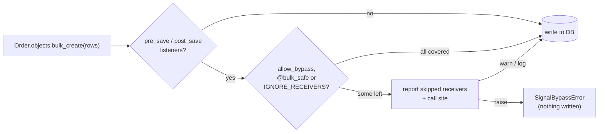

<div align="center">

# 🛡️ django-signal-guard

**Make Django signal failures loud.**

Catch the bulk writes that silently skip your `pre_save` / `post_save` receivers,<br>
the receivers that never get connected, run twice, loop forever,<br>
or send the email before the transaction commits.

[](https://github.com/panosangelopoulos/django-signal-guard/actions/workflows/ci.yml)
[](#-install)
[](#-install)
[](https://pypi.org/project/django-signal-guard/)
[](https://pepy.tech/project/django-signal-guard)
[](#%EF%B8%8F-roadmap)
[](https://peps.python.org/pep-0561/)
[](https://github.com/astral-sh/ruff)
[](https://github.com/panosangelopoulos/django-signal-guard/blob/main/LICENSE)

[Quick start](#-quick-start) •
[Bypass guard](#-the-bypass-guard) •
[Recursion](#-recursion-tracing) •
[Before commit](#-side-effects-before-commit) •
[System checks](#-system-checks) •
[signals.lock](#-the-signal-map-and-signalslock) •
[pytest](#-which-test-hit-it-the-pytest-plugin) •
[Configuration](#%EF%B8%8F-configuration) •
[How it works](#-how-it-works)

</div>

---

## 💥 The problem

```python
Order.objects.bulk_create(rows)  # post_save never fires
Order.objects.filter(...).update(...)  # neither does pre_save
```

`bulk_create()`, `bulk_update()` and `update()` write rows **without calling
`Model.save()`**, so your `pre_save` and `post_save` receivers never run.

Nothing errors. The search index goes stale, the audit log has gaps, a cache is
never invalidated. You usually find out days later, in production.

## ✅ The fix

`django-signal-guard` catches those writes in development, tests and CI, and
tells you exactly which receivers were skipped and where the call came from:

```text
SignalBypassError: QuerySet.bulk_create() on shop.Order skips 2 receivers:
  pre_save   shop.signals.normalize_status  (shop/signals.py:5)
  post_save  shop.signals.reindex_order  (shop/signals.py:9)
Called from shop/imports.py:42.
Run the receivers' work yourself, or wrap the call in signal_guard.allow_bypass(Order, reason="...").
```

It doesn't add new signals or replace them with hooks. Your signals stay
exactly as they are. It just **reports misuse**, the way
[`nplusone`](https://github.com/jmcarp/nplusone) and
[`django-seal`](https://github.com/charettes/django-seal) report lazy queries.

## ✨ What's inside

| | Feature | What it catches |
| :---: | --- | --- |
| 🚧 | **[Bypass guard](#-the-bypass-guard)** | Bulk writes that skip receivers: raise, warn or log. |
| 🔁 | **[Recursion tracing](#-recursion-tracing)** | A receiver that saves its own instance and loops, with the whole chain. |
| ⏳ | **[Before-commit check](#-side-effects-before-commit)** | Emails, Celery tasks and HTTP calls made before the transaction commits. |
| ✅ | **[`@receiver_on_commit`](#the-fix-receiver_on_commit)** | A drop-in `@receiver` that runs after the commit. |
| 🩺 | **[System checks](#-system-checks)** | Receivers that never run, only run in some processes, die silently, or run twice. |
| 🔒 | **[`signals.lock`](#-the-signal-map-and-signalslock)** | A committed inventory of every receiver, checked in CI, so new receivers show up in code review. |

---

## 📦 Install

```bash
pip install django-signal-guard
```

Requires **Python 3.10+** and **Django 5.2+**.

With uv, add it to the project (`uv add --dev django-signal-guard`) rather
than trying it with `uv run --with django-signal-guard`: `--with` resolves the
package's dependencies on their own, so it can install a different Django from
the one your project pins.

## 🚀 Quick start

**1. Add it to `INSTALLED_APPS`, first in the list:**

```python
# settings.py
INSTALLED_APPS = [
    "signal_guard",  # first, so it sees every receiver being connected
    # ...
]
```

**2. Make every finding fail your tests:**

```python
# settings/test.py
SIGNAL_GUARD = {"BYPASS": "raise", "RECURSION": "raise", "SIDE_EFFECTS": "raise"}
```

**3. Add two lines to CI:**

```bash
python manage.py check --tag signals --fail-level WARNING
python manage.py signal_map --check
```

That's it. Everywhere else, the default is `"warn"`.

---

## 🚧 The bypass guard

Every `bulk_create()`, `bulk_update()` and `update()` (plus `abulk_create()`,
`abulk_update()`, `aupdate()`) is checked against the live `pre_save` and
`post_save` receivers for that model. A model with no receivers costs a single
`has_listeners()` call.

### When skipping is intended

Wrap the call in `allow_bypass` and say why. The `reason` is **required**, so
the decision is written down next to the code:

```python
from signal_guard import allow_bypass

with allow_bypass(Order, reason="import reindexes in one batch"):
    Order.objects.bulk_create(rows)
reindex_orders(rows)
```

- `allow_bypass()` with no models allows every model.
- It also works as a **decorator** and with **`async with`**.

### Receivers that never matter for bulk writes

Mark them once with `@bulk_safe`:

```python
from django.db.models.signals import post_save
from django.dispatch import receiver
from signal_guard import bulk_safe


@receiver(post_save, sender=Order)
@bulk_safe
def warm_cache(sender, instance, **kwargs): ...
```

### Cutting the noise on a large project

On a big codebase most reports are about receivers you can't or needn't
change. These settings each drop one kind. They are all off by default:

```python
SIGNAL_GUARD = {
    # easy_thumbnails, imagekit and the like connect receivers for every
    # model (sender=None), so every update() on every model would skip them.
    "LIBRARY_RECEIVERS": "ignore_global",
    # Data migrations work on historical models, which never run your
    # receivers anyway.
    "IGNORE_HISTORICAL_MODELS": True,
    # post_save receivers that start with `if not created: return` (or are
    # one `if created:` block) do nothing on update() and bulk_update().
    "IGNORE_CREATE_ONLY_RECEIVERS": True,
    # A post_save receiver that writes to its own model with update(), on
    # purpose, so it doesn't run itself again.
    "IGNORE_RECEIVER_SELF_UPDATES": True,
}
```

- **`LIBRARY_RECEIVERS`**: `"report"` (default) reports every receiver;
  `"ignore_global"` skips receivers from installed packages that are
  connected for every sender, but keeps those connected to your models, such
  as `simple_history`'s; `"ignore"` skips all receivers from installed
  packages. What counts as yours follows `FIRST_PARTY`. To silence specific
  receivers instead, use `IGNORE_RECEIVERS`, e.g.
  `["easy_thumbnails.*", "imagekit.*"]`.
- **`IGNORE_CREATE_ONLY_RECEIVERS`** is a **heuristic**: it reads the
  receiver's source and only recognises those two shapes. Even with it off,
  such receivers are marked `[create-only?]` in reports. `bulk_create()` still
  reports them, since it does create rows.
- **`IGNORE_RECEIVER_SELF_UPDATES`** only covers writes to the same model as
  the `pre_save` / `post_save` being handled. Even with it off, the report says
  which receiver it runs in. Bear in mind the write still skips the model's
  *other* receivers.

A manager or queryset that overrides `update()` (to set `updated_at`, say)
and calls `super()` is not blamed for every call: the report names the line
that called it, and the override after "through":

```text
Called from shop/views.py:42, through shop/managers.py:9 (TimestampedQuerySet.update()).
```

<details>
<summary><b>What the guard covers, and what it doesn't</b></summary>

<br>

**Covered**

- `bulk_create()`, `bulk_update()` and `update()`, called on a manager, a
  queryset, or your own `QuerySet` subclass methods.
- The async variants `abulk_create()`, `abulk_update()` and `aupdate()`.
- Receivers connected to the model, and receivers connected to every sender.
- `bulk_update()` is reported once, even though Django runs `update()` inside it.
- Managers and querysets, yours or a library's, that override one of the
  three methods and call `super()`: the caller is reported, not the override.

**Not covered**

- Raw SQL, `cursor.execute()`, database triggers and other writes that never
  go through a `QuerySet`.
- `QuerySet.delete()`. It *does* send `pre_delete` and `post_delete`; it only
  skips your model's own `delete()` method.
- Logic in an overridden `Model.save()` with no signal receiver. The guard only
  knows about receivers.
- A `QuerySet` subclass that overrides one of the three methods and never calls
  `super()`.

</details>

---

## 🔁 Recursion tracing

A `post_save` receiver that calls `instance.save()` sends `post_save` again,
which calls the receiver again. You get a `RecursionError` a thousand frames
deep, or, worse, a loop that ends on its own after hammering the database.

`django-signal-guard` traces every signal being sent. When the same signal is
sent for the same object while it is already being handled twice, it stops
and shows you the loop:

```text
SignalRecursionError: shop.signals.sync_total re-entered for shop.Order #12:
  post_save  shop.Order #12 → shop.signals.sync_total  (shop/signals.py:20)
    Order.save()  shop/signals.py:24
  post_save  shop.Order #12 → shop.signals.sync_total  (shop/signals.py:20)
    Order.save()  shop/signals.py:24
  post_save  shop.Order #12  ← this send
Stop the loop with a guard (check update_fields or a flag on the instance), or write the change with QuerySet.update().
```

- **Saving once more is fine.** The common `if created: instance.save()`
  pattern re-enters once and stops, so it is never reported.
- **Same row, any object.** `Order.objects.get(pk=instance.pk).save()` inside
  the receiver is the same loop, and is caught.
- **Cycles too.** `Order` → `Invoice` → `Order` → … shows every hop.
- Set `"RECURSION"` to `raise`, `warn` (default), `log` or `off`.

---

## ⏳ Side effects before commit

```python
@receiver(post_save, sender=Order)
def send_confirmation(sender, instance, created, **kwargs):
    send_order_email.delay(instance.pk)  # 💥 the worker may run before COMMIT
```

Inside a transaction (`ATOMIC_REQUESTS`, `transaction.atomic()`, or Django's
own around `delete()`), a receiver runs **before the data is committed**. The
Celery worker looks for the order and gets `DoesNotExist`. The confirmation
email goes out even when the transaction rolls back.

`django-signal-guard` reports these calls when a receiver makes them inside a
transaction that has not committed:

| Side effect | Calls that are checked |
| --- | --- |
| 📧 Email | `send_mail()`, `EmailMessage.send()`, `mail_admins()`, `send_mass_mail()` |
| 🥬 Celery | `Task.delay()`, `Task.apply_async()` (when Celery is installed) |
| 🌐 HTTP | `requests`, `httpx` (sync and async clients), when installed |
| 🧩 Your own | Any function or method listed in `SIDE_EFFECT_CALLS` |

```text
SideEffectBeforeCommitError: Celery task shop.tasks.send_order_email is queued before the transaction on 'default' commits.
  receiver   shop.signals.send_confirmation  (shop/signals.py:30)
  called at  shop/signals.py:33
A worker can run it before the row is committed, and it still runs if the transaction rolls back.
Connect the receiver with @signal_guard.receiver_on_commit, or wrap the call in transaction.on_commit().
```

The transaction that `TestCase` (and `pytest.mark.django_db`) wraps each test
in does not count: in production that code runs in autocommit mode. Your own
`transaction.atomic()` blocks inside a test do count.

```python
SIGNAL_GUARD = {
    "SIDE_EFFECTS": "warn",  # raise | warn | log | off
    "SIDE_EFFECT_CALLS": ["shop.webhooks.post", "shop.payments.Client.charge"],
}
```

### The fix: `@receiver_on_commit`

A drop-in replacement for `@receiver` that hands the call to
`transaction.on_commit()`:

```python
from signal_guard import receiver_on_commit


@receiver_on_commit(post_save, sender=Order)
def send_confirmation(sender, instance, created, **kwargs):
    if created:
        send_order_email.delay(instance.pk)  # ✅ the row is committed now
```

- The receiver gets **exactly the arguments the signal sent**.
- **Rolled back? It never runs.** Outside a transaction it runs at once.
- It uses the database the signal names in `using` (model signals do), or
  `using=` you pass, or the default database.
- Takes `sender`, `weak`, `dispatch_uid`, a list of signals, and `robust=True`
  to log an exception instead of stopping the other commit callbacks.
- Returns your function unchanged, so you can still call it in tests.
  `signal_map` labels these receivers `on commit`.

### Tasks queued while a row is deleted

A `pre_delete` or `post_delete` receiver that queues `cleanup.delay(instance.pk)`
has a worse problem: once the delete commits the row is gone, so a task that
re-reads it with `.objects.get(pk=...)` finds nothing and quietly does
nothing. Moving the call to `on_commit()` doesn't help. The report says so:
pass the task the values it needs, then queue it on commit.

### When the side effect must happen first: `allow_side_effect`

Sometimes the call has to happen inside the transaction, for example a
vendor's cancel API whose refusal must roll the local delete back. Allow it
and say why, as with `allow_bypass`:

```python
from signal_guard import allow_side_effect


@receiver(pre_delete, sender=Subscription)
@allow_side_effect(reason="a refused cancel must roll the delete back")
def cancel_at_vendor(sender, instance, **kwargs):
    vendor.cancel(instance.vendor_id)
```

It also works as a context manager and with `async with`.

<details>
<summary><b>Limits of the side-effect check</b></summary>

<br>

- Only calls made while a **signal receiver** is running are checked. A view
  that sends email inside `atomic()` is out of scope.
- Calls are wrapped when Django starts. Code that ran
  `from django.core.mail import send_mass_mail` before then keeps the
  unwrapped function. `send_mail()` and `EmailMessage.send()` are always
  covered. The same goes for `SIDE_EFFECT_CALLS` functions imported by name
  before `signal_guard` is ready, so list functions that your receivers
  import in `ready()` or later.
- Receivers from installed packages are skipped unless `CHECK_LIBRARY_CALLS`
  is on; `IGNORE_RECEIVERS` patterns apply too.
- When your receiver calls a vendor SDK that makes the HTTP call, "called at"
  is the line in your receiver, not the line inside the SDK.

</details>

---

## 🩺 System checks

```bash
python manage.py check --tag signals
```

| ID | Finds | Why it matters |
| --- | --- | --- |
| **`W001`** | A module in one of your apps defines `@receiver` functions, but nothing imports it. | The decorator never runs, so the receiver never runs. The classic *"my signal doesn't fire"*. |
| **`W002`** | A receiver is connected only after startup, by a lazy import such as `views.py` importing your signals module. | Web requests run it, but **Celery workers**, management commands and some tests never do. |
| **`W003`** | A weakly connected function or lambda was garbage-collected. | Django holds receivers by weak reference, so a nested function or lambda silently stops running. |
| **`W004`** | The same receiver is connected more than once to one signal and sender. | Every copy runs, so **emails go out twice**. |

<details>
<summary><b>Example output</b></summary>

```text
shop.webhooks: (signal_guard.W002) shop.webhooks.send_webhook is connected only after startup, when shop/views.py:2 imports it.
	HINT: Processes that never run that import, such as Celery workers, management commands and some tests, never run this receiver. Import shop.webhooks in shop.apps.ShopConfig.ready().
```

</details>

All four are warnings, so they never stop `runserver`. Silence one with
`SILENCED_SYSTEM_CHECKS = ["signal_guard.W004"]`.

---

## 🔒 The signal map and `signals.lock`

See which receivers run for which signal and sender: yours, plus third-party
receivers that run on your models (add `--all` for Django's internals).

```console
$ python manage.py signal_map
First-party receivers (3)
  django.db.models.signals.post_save
    shop.Order
      shop.signals.reindex_order  (shop/signals.py:9)
      shop.webhooks.send_webhook  (shop/webhooks.py:6)
  django.db.models.signals.pre_save
    shop.Order
      shop.signals.normalize_status  (shop/signals.py:5)
```

Commit the same list as a lock file:

```bash
python manage.py signal_map --write   # writes signals.lock
python manage.py signal_map --check   # fails with a diff when it's out of date
```

```text
[first-party]
django.db.models.signals.post_save | shop.Order | shop.signals.reindex_order
django.db.models.signals.post_save | shop.Order | shop.webhooks.send_webhook
django.db.models.signals.pre_save | shop.Order | shop.signals.normalize_status
```

One line per receiver, no line numbers, so the file only changes when a
receiver is added, removed or moved. That includes receivers a **dependency
upgrade** quietly adds to your models.

---

## 🧪 Which test hit it: the pytest plugin

Run the suite in `log` mode with `--signal-guard-summary` to get every report
grouped by the line it blames, with a count and the tests that hit it:

```console
$ pytest --signal-guard-summary
...
============================= signal-guard summary =============================
4 reports at 2 call sites.

shop/imports.py:42  bypass  3 reports in 2 tests
    QuerySet.bulk_create() on shop.Order skips 2 receivers:
    - shop/tests/test_imports.py::test_import_rows
    - shop/tests/test_imports.py::test_reimport

shop/signals.py:33  side_effect  1 report in 1 test
    Celery task shop.tasks.send_order_email is queued before the transaction on 'default' commits.
    - shop/tests/test_views.py::test_checkout
```

The plugin is installed with the package and does nothing without the flag.
It works with `pytest-xdist`. Reports are counted in every mode, so `warn`
and `raise` work too, but `log` lets the run reach the end.

In `log` mode each record also carries `signal_guard_kind`,
`signal_guard_location` (the blamed `path:line`) and `signal_guard_test` (the
pytest node id, when one is running), for your own log handlers.

---

## ⚙️ Configuration

Every key is optional:

```python
SIGNAL_GUARD = {
    "BYPASS": "warn",  # raise | warn | log | off
    "RECURSION": "warn",  # raise | warn | log | off
    "SIDE_EFFECTS": "warn",  # raise | warn | log | off
    "SIDE_EFFECT_CALLS": [],  # e.g. ["shop.webhooks.post"]
    "IGNORE_RECEIVERS": [],  # fnmatch patterns, e.g. ["simple_history.*"]
    "LIBRARY_RECEIVERS": "report",  # report | ignore_global | ignore
    "IGNORE_HISTORICAL_MODELS": False,
    "IGNORE_CREATE_ONLY_RECEIVERS": False,
    "IGNORE_RECEIVER_SELF_UPDATES": False,
    "CHECK_LIBRARY_CALLS": False,
    "FIRST_PARTY": None,  # e.g. ["shop", "billing"]
    "LOCK_FILE": "signals.lock",
    "ENABLED": True,
}
```

| Key | Default | Description |
| --- | --- | --- |
| `BYPASS` | `"warn"` | `raise` stops the write with `SignalBypassError` **before anything reaches the database**. `warn` emits a `SignalBypassWarning`. `log` writes to the `signal_guard` logger. `off` does nothing. |
| `RECURSION` | `"warn"` | What to do when a receiver re-enters itself for the same object twice. `raise` stops before the third run. |
| `SIDE_EFFECTS` | `"warn"` | What to do when a receiver sends email, queues a Celery task or makes an HTTP call before the transaction commits. `raise` stops the call before it happens. |
| `SIDE_EFFECT_CALLS` | `[]` | Dotted paths of your own functions or methods that count as side effects. A path that cannot be imported fails at startup. |
| `IGNORE_RECEIVERS` | `[]` | Receivers whose dotted path matches one of these patterns are never reported, by any check. Handy for third-party receivers you can't change. |
| `LIBRARY_RECEIVERS` | `"report"` | For the bypass guard: `ignore_global` skips receivers from installed packages connected for every sender (`sender=None`); `ignore` skips all receivers from installed packages. See [cutting the noise](#cutting-the-noise-on-a-large-project). |
| `IGNORE_HISTORICAL_MODELS` | `False` | Skip bulk writes on the historical models that migrations use. |
| `IGNORE_CREATE_ONLY_RECEIVERS` | `False` | For `update()` and `bulk_update()`, skip `post_save` receivers that only act when `created`. A heuristic, read from the source. |
| `IGNORE_RECEIVER_SELF_UPDATES` | `False` | Skip bulk writes a `pre_save` / `post_save` receiver makes to the model it handles. |
| `CHECK_LIBRARY_CALLS` | `False` | Also report bulk writes made inside Django or installed packages, such as the `UPDATE` behind `on_delete=SET_NULL`, and side effects in their receivers. |
| `FIRST_PARTY` | `None` | Module prefixes of your own code. By default, anything not Django and not in site-packages counts as yours. |
| `LOCK_FILE` | `"signals.lock"` | Where `signal_map --write` / `--check` keep the lock file. Relative paths resolve against `settings.BASE_DIR` when it exists. |
| `ENABLED` | `True` | When `False` at startup, nothing is wrapped and every check does nothing. |

> **Tip:** settings are read on every call, so `override_settings` just works in tests.

---

## 🔍 How it works



- **Bypass guard.** On app load it wraps `QuerySet.bulk_create`, `bulk_update`
  and `update`. Before each write it asks Django's dispatcher which `pre_save`
  and `post_save` receivers are live for the model, drops those marked
  `@bulk_safe` or matching `IGNORE_RECEIVERS`, and reports the rest.
- **Tracing.** It wraps `Signal.send()`, `send_robust()`, `asend()` and
  `asend_robust()` to keep a per-context stack of the signals being sent.
  Recursion is a match on that stack; the receiver at each hop is found by
  walking Python frames, only when something is reported. Each send costs
  under a microsecond more, small next to the database write behind it.
- **Side effects.** At startup it wraps the email, Celery, HTTP and
  `SIDE_EFFECT_CALLS` functions. Each call first asks: is a receiver running,
  and is a transaction open that `TestCase` did not open? Only then does it
  look up the receiver and report.
- **Registry.** It wraps `Signal.connect()` and `disconnect()` to record where
  and when each receiver was connected. It holds only weak references, so it
  never keeps a receiver alive. That's why `signal_guard` should come **first**
  in `INSTALLED_APPS`: a receiver connected before it loads has no record, so
  W003 can't see it die.
- **Checks and map.** They import your URLconf first, as a running server
  would, then read Django's live receivers. W001 also parses your apps' modules
  (skipping tests and migrations) to find `@receiver` functions.

---

## 🗺️ Roadmap

| Version | Adds | |
| --- | --- | :---: |
| 0.1 | Bypass guard | ✅ |
| 0.2 | System checks W001–W004, `manage.py signal_map`, `signals.lock` | ✅ |
| 0.3 | Recursion tracing, `@receiver_on_commit`, a check for side effects before commit | ✅ |
| 0.4 | Noise controls for large projects, `allow_side_effect`, `pytest --signal-guard-summary` | ✅ |
| 1.0 | Test assertions, full documentation | 🔜 |

See the [changelog](https://github.com/panosangelopoulos/django-signal-guard/blob/main/CHANGELOG.md) for details.

## 📚 Prior art

- **Johnny Metz's post** on blocking bulk operations that skip signals, which
  shows the same idea as a custom `QuerySet`.
- **`django-bulk-signals`, `django-bulk-tracker`** and similar packages add
  *new* bulk signals. Use them if you want receivers that do run on bulk writes;
  `django-signal-guard` tells you when your *existing* receivers don't.
- **`django-lifecycle`** replaces signals with model hooks.

## 🧑‍💻 Development

```bash
uv sync --group dev
uv run pytest
uv run ruff check . && uv run ruff format --check .
```

Issues and pull requests are welcome.

## 📄 License

[BSD-3-Clause](https://github.com/panosangelopoulos/django-signal-guard/blob/main/LICENSE), the same as Django.
