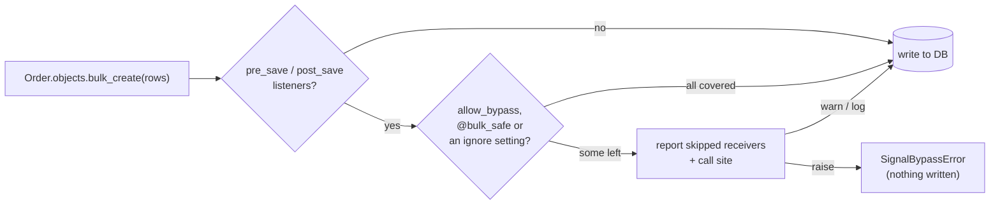

# How it works

django-signal-guard changes no behaviour of yours. When Django loads it, it
wraps a few methods so it can look before they run, and reports what it
sees.

## Bypass guard

`QuerySet.bulk_create()`, `bulk_update()` and `update()` are wrapped. The
async variants call them, so they are covered too. Before each write, the
guard asks Django's dispatcher which `pre_save` and `post_save` receivers
are live for the model. It drops those marked `@bulk_safe` or matched by a
setting, and reports the rest with the call site: the first frame of your
code, past Django's manager proxy and any `update()` override.

## Tracing

`Signal.send()`, `send_robust()`, `asend()` and `asend_robust()` are wrapped
to keep a per-context stack of the signals being sent. Recursion is a match
on that stack. The receiver at each hop is found by walking Python frames,
and only when something is reported. A send that Django knows no receiver
will handle is not traced at all.

The same wrappers record signals for
[`capture_signals()`](guide/testing.md#signals-sent), and only while one is
open.

## Side effects

At startup it wraps the email, Celery, HTTP and `SIDE_EFFECT_CALLS`
functions. Each call first asks: is a receiver running, and is a transaction
open that `TestCase` did not open? Only then does it look up the receiver and
report.

## Registry

`Signal.connect()` and `disconnect()` are wrapped to record where and when
each receiver was connected. The registry holds only weak references, so it
never keeps a receiver alive. That's why `signal_guard` should come **first**
in `INSTALLED_APPS`: a receiver connected before it loads has no record, so
W003 can't see it die.

## Checks and map

They import your URLconf first, as a running server would, then read
Django's live receivers. W001 also parses your apps' modules (skipping tests
and migrations) to find `@receiver` functions.

## Reports

Every check builds one report and hands it on in this order:

1. to an open [capture](guide/testing.md#reports) from
   `signal_guard.testing` that wants it, which keeps it;
2. otherwise to the [pytest plugin](guide/pytest.md), for the summary and
   the baseline;
3. then, unless the baseline knows it, it is raised, warned or logged, as
   the mode says.

## Private APIs

Two private parts of Django's dispatcher are used, both with a fallback:

- `Signal._live_receivers()`, to name the receivers a write would skip.
  Without it, the guard can still tell *that* receivers are skipped, but not
  which.
- `Signal.sender_receivers_cache` and `NO_RECEIVERS`, the shortcut Django's
  own `send()` takes. Without them, every send is traced.

CI runs against Django's main branch, so a change there shows up early.
